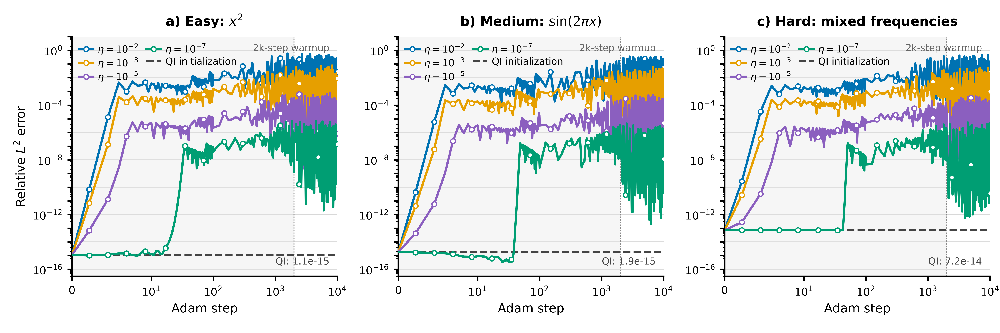

# QI initialization followed by Adam: results

All 12 runs completed 10,000 updates with a 2,000-update linear warmup. Every final checkpoint is less accurate than its own QI initialization. This is an observation for this fixed schedule, parameterization, and target suite; it does not establish that every Adam schedule must lose accuracy.

## Final held-out relative L2

| Target | Initial QI | lr=0.01 | lr=0.001 | lr=0.00001 | lr=0.0000001 |
|---|---:|---:|---:|---:|---:|
| square | 1.088e-15 | 2.583e-02 | 8.952e-03 | 8.267e-07 | 1.388e-07 |
| sine | 1.855e-15 | 5.438e-02 | 2.565e-05 | 4.791e-06 | 1.132e-08 |
| sine_mixture | 7.206e-14 | 2.350e-02 | 9.275e-04 | 6.962e-10 | 3.631e-11 |

The endpoints occur at different phases of large oscillations. They should not be read as stable plateaus or a monotone ordering of learning rates. In particular, the hard target at lr=1e-5 ends at 6.96e-10 even though its median logged error after warmup is about 1.10e-6.

## Post-warmup trajectories

These statistics use the 321 held-out observations at steps 2,000, 2,025, ..., 10,000. They are descriptive, not independent replicates; the minimum is a minimum over logged evaluations, not every update.

| Target | Learning rate | Minimum logged | Median logged | Maximum logged |
|---|---:|---:|---:|---:|
| square | 0.01 | 4.495e-05 | 1.638e-02 | 5.638e-01 |
| square | 0.001 | 1.815e-07 | 1.724e-04 | 7.800e-02 |
| square | 1e-05 | 2.449e-10 | 6.114e-07 | 7.950e-04 |
| square | 1e-07 | 1.961e-12 | 1.664e-08 | 6.634e-06 |
| sine | 0.01 | 6.495e-04 | 5.728e-03 | 3.432e-01 |
| sine | 0.001 | 1.073e-05 | 1.618e-04 | 6.155e-02 |
| sine | 1e-05 | 9.262e-10 | 9.377e-07 | 5.507e-04 |
| sine | 1e-07 | 2.043e-13 | 6.856e-09 | 4.425e-06 |
| sine_mixture | 0.01 | 1.431e-04 | 1.380e-03 | 4.546e-01 |
| sine_mixture | 0.001 | 1.476e-06 | 1.358e-04 | 5.026e-02 |
| sine_mixture | 1e-05 | 2.776e-10 | 1.105e-06 | 4.206e-04 |
| sine_mixture | 1e-07 | 5.574e-13 | 3.316e-09 | 5.350e-06 |

## Verification and interpretation

- Independent 2,048-point Gauss-Legendre endpoint errors agree with midpoint errors to within 9.20e-05 relative discrepancy (less than 0.01%). Initial values are near float64 roundoff and can differ modestly across evaluation rules.
- Tests passed: QI-to-Torch function preservation; exact zero-learning-rate control; identical initial parameters across rates; disjoint train/evaluation grids; update indexing and warmup endpoints.
- Initial full-batch gradient norms are nonzero, around 4.7e-15, 8.3e-15, and 5.6e-14. Thus this is a high-accuracy finite-precision solution, not an exact zero-gradient mathematical state. Adam has an initial residual to act on; these runs alone do not isolate a full causal mechanism for the later instability.
- All initial models satisfy the prespecified relative-L2 ceiling of 1e-12. No readout solve or optimizer intervention occurs after construction. All rates, including unfavorable traces, are plotted.

## Figures and reproduction

The three panels use the paper's **Width Scaling / Bandwidth Selection / Precision Law** styling directly through its shared style module. Gray shading denotes warmup; dashed horizontal lines denote initial QI errors. The main x axis is logarithmic above step 1 and linear between 0 and 1. Curves connect unsmoothed logged evaluations. The hard target is sin(2πx) + 0.5 sin(6πx) + 0.25 sin(14πx).

- Main: `qi_adam_drift.png`, `qi_adam_drift.pdf`.
- Linear step axis: `qi_adam_drift_linear.png`, `qi_adam_drift_linear.pdf`.
- Exact config and provenance: `config.json`, `provenance.json`, `figure_provenance.json`.
- Numerical summary: `summary.csv`; per-target traces and initial/final checkpoints in the three target directories.
- Protocol and reproduction commands: `experiments/expD55_qi_adam_drift/README.md` from the repository root.
