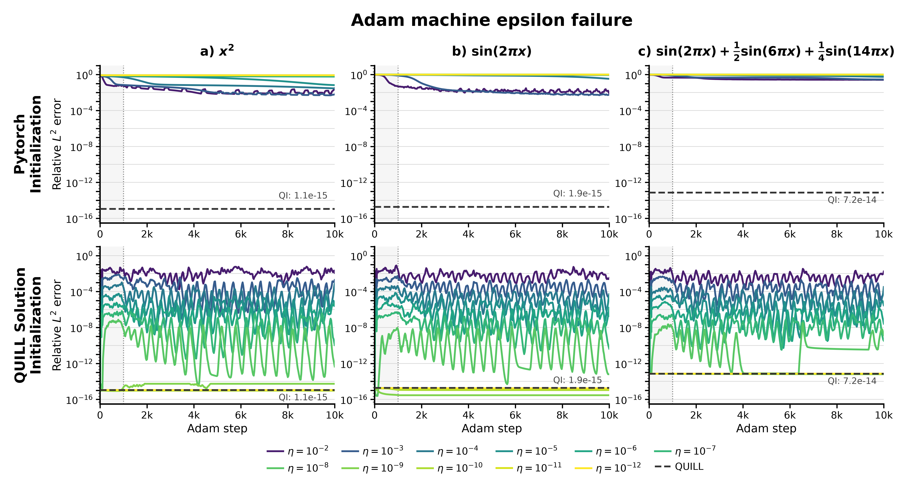

# Matched 2-by-3 initialization comparison

The comparison contains 66 measured 10,000-step trajectories: three targets, two initializations, and eleven peak learning rates from 1e-2 through 1e-12. Thirty existing trajectories at rates 1e-2 through 1e-6 are reused, and 36 new trajectories at rates 1e-7 through 1e-12 are saved here. The manifest records each curve's source. The existing 50k standard runs remain separately preserved.

Both rows use the same 269-neuron tanh architecture, data, float64 arithmetic, seed 0, full-batch MSE, Adam defaults, and 1,000-step linear warmup. Standard initializations are identical across rates; constructed initializations are identical across rates for each target. This is a matched single-seed comparison.

## Warmup

Update t uses eta_t = eta_peak * min(t/1000, 1), for t starting at 1. Step 0 is only the initial measurement. The first rate is eta_peak/1000, which is three orders below the peak. Each warmup update adds the same increment eta_peak/1000; update 100 reaches 10% of the peak, and update 1,000 reaches the peak. This is not a logarithmic ramp. The smallest first learning rate in this sweep is 1e-15, corresponding to peak 1e-12.

A learning rate is not a parameter displacement. On the first Adam update, with fresh zero moments, the exact-arithmetic coordinate update is approximately `-eta_1*g/(abs(g)+1e-8)`; floating-point rounding also matters for extremely small updates.

## Raw endpoint errors

| Peak LR | First LR | x²: standard | x²: QI | Sine: standard | Sine: QI | Mixture: standard | Mixture: QI |
|---|---|---:|---:|---:|---:|---:|---:|
| 1e-02 | 1e-05 | 1.829e-02 | 2.031e-03 | 7.319e-03 | 9.011e-02 | 2.589e-01 | 6.207e-03 |
| 1e-03 | 1e-06 | 5.088e-03 | 1.501e-02 | 4.960e-03 | 2.192e-05 | 2.813e-01 | 9.747e-03 |
| 1e-04 | 1e-07 | 2.856e-02 | 1.586e-04 | 3.306e-01 | 1.964e-07 | 5.474e-01 | 3.019e-04 |
| 1e-05 | 1e-08 | 6.605e-02 | 4.748e-08 | 8.881e-01 | 6.168e-06 | 8.812e-01 | 4.354e-07 |
| 1e-06 | 1e-09 | 5.950e-01 | 8.530e-07 | 9.290e-01 | 5.620e-06 | 9.213e-01 | 1.377e-09 |
| 1e-07 | 1e-10 | 7.186e-01 | 6.756e-11 | 9.834e-01 | 2.021e-11 | 9.839e-01 | 1.539e-10 |
| 1e-08 | 1e-11 | 8.246e-01 | 1.855e-13 | 1.010e+00 | 6.078e-14 | 1.009e+00 | 6.400e-11 |
| 1e-09 | 1e-12 | 8.379e-01 | 5.418e-15 | 1.013e+00 | 2.878e-16 | 1.011e+00 | 6.256e-14 |
| 1e-10 | 1e-13 | 8.393e-01 | 9.343e-16 | 1.014e+00 | 1.083e-15 | 1.012e+00 | 7.118e-14 |
| 1e-11 | 1e-14 | 8.394e-01 | 1.084e-15 | 1.014e+00 | 1.629e-15 | 1.012e+00 | 7.181e-14 |
| 1e-12 | 1e-15 | 8.394e-01 | 1.089e-15 | 1.014e+00 | 1.683e-15 | 1.012e+00 | 7.187e-14 |

The expanded sweep distinguishes the two regimes. Very small rates barely change the standard-initialized model during this budget, while peak rates around 1e-9 and smaller retain near-construction precision. Thus these data do not support a statement that Adam must destroy a constructed solution at every positive learning rate.

Endpoint accuracy alone can hide excursions. At peak 1e-8, for example, the square model ends near 1.9e-13 but its maximum logged post-warmup error is about 1.1e-6. `checkpoint_checks.json` and `summary.csv` retain post-warmup statistics; maxima are over logged held-out evaluations, not a claim to observe every intermediate held-out error.

## Figures and data

Rows are standard and constructed initialization; columns are x², sin(2πx), and sin(2πx)+0.5 sin(6πx)+0.25 sin(14πx). Both rows use linear x-axes through 10k, identical y-limits and colors, and all eleven rates. The dashed line is the initial constructed accuracy. Gray shading denotes warmup. The figure uses viridis colors, a bottom legend, and 150-step log-error smoothing (seven samples at 25-step spacing); the first 100 updates are raw. The unsmoothed figure is `comparison_2x3_raw.png` / `.pdf`.

The six new target/initialization directories contain every training loss and learning rate, held-out histories (every update through 100, then every 25 updates), initial/final models, and complete model/Adam checkpoints every 2,500 updates. The previous rates remain at their manifest paths. `displayed_curves.json` saves raw and plotted values; `figure_provenance.json` records input hashes and smoothing.

All 66 final checkpoints exactly reproduce their saved errors, all learning-rate schedules were checked, and every new initial model and data grid matches its original counterpart. No additional optimizer or readout fitting is applied in these curves.

Reproduction commands and the full protocol are in `experiments/expD55_qi_adam_drift/README.md`.
