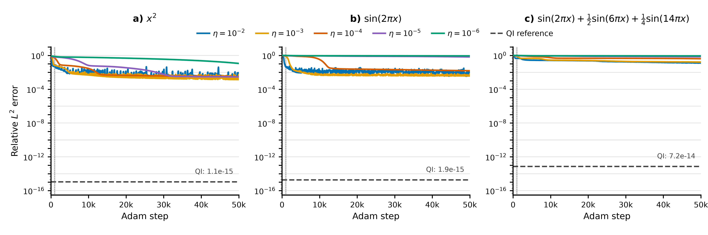

# Standard initialization: 50,000-step extension

All 15 standard-initialization runs completed 50,000 full-batch Adam updates. The first 10,000 updates reproduce the previous experiment exactly: initial weights, every saved error, every training loss and learning rate, and the 10k model parameters all match bit for bit. The 1,000-step warmup, five peak rates, seed 0, architecture, data, float64 arithmetic, and Adam settings are unchanged.

## Raw endpoint comparison

| Target | Learning rate | Error at 10k | Error at 50k |
|---|---:|---:|---:|
| square | 0.01 | 1.829e-02 | 3.188e-03 |
| square | 0.001 | 5.088e-03 | 2.076e-03 |
| square | 0.0001 | 2.856e-02 | 3.064e-03 |
| square | 1e-05 | 6.605e-02 | 2.922e-03 |
| square | 1e-06 | 5.950e-01 | 1.133e-01 |
| sine | 0.01 | 7.319e-03 | 1.139e-02 |
| sine | 0.001 | 4.960e-03 | 1.792e-02 |
| sine | 0.0001 | 3.306e-01 | 1.553e-02 |
| sine | 1e-05 | 8.881e-01 | 6.689e-01 |
| sine | 1e-06 | 9.290e-01 | 8.949e-01 |
| sine_mixture | 0.01 | 2.589e-01 | 1.238e-01 |
| sine_mixture | 0.001 | 2.813e-01 | 1.680e-01 |
| sine_mixture | 0.0001 | 5.474e-01 | 4.083e-01 |
| sine_mixture | 1e-05 | 8.812e-01 | 6.943e-01 |
| sine_mixture | 1e-06 | 9.213e-01 | 8.882e-01 |

These are raw checkpoint errors; oscillatory traces can end at different phases. The smoothed figures are for display, and numerical summaries do not use smoothed values.

## Saved data

Each target directory has the initial network, full train/evaluation grids, and five runs. Each run retains:

- Raw held-out and training relative L2 histories: every update through 100, then every 25 updates through 50,000.
- Every pre-update training MSE and learning rate in `lr_*_all_steps.npz` (50,000 entries).
- Complete checkpoints at 10k, 20k, 30k, 40k, and 50k: model, Adam moments and step counters, RNG state, configuration, and accumulated histories.
- A separate final model state and summary JSON.

Full checkpoints are `lr_<rate>_step_<six-digit-step>.pt`. The original 10k results remain preserved in the sibling `standard_init_warmup1000` directory.

## Figures

Both views have a fully linear x-axis. The 50k view uses 0, 10k, 20k, 30k, 40k, 50k ticks; the 10k view uses 0, 2k, 4k, 6k, 8k, 10k ticks. Titles, legend placement, colors, fonts, y limits, and 100-step log-error smoothing are unchanged. The dashed line remains the QI initialization reference. Cropping occurs before smoothing, so the 10k plot does not incorporate observations after step 10,000.

- `standard_adam.png` / `.pdf`: full 50k view.
- `standard_adam_10k.png` / `.pdf`: first 10k steps only.
- Corresponding `_raw` files: unsmoothed views.
- `displayed_curves.json` and `displayed_curves_10k.json`: exact plotted samples.
- `summary.csv`: full-run numerical summary.

## Validation

All 750,000 training losses are finite. All 75 complete checkpoints and all 15 final checkpoints were checked. Independent Gauss-Legendre endpoint errors differ from the midpoint rule by at most 3.315e-05 relatively. Seven targeted tests pass, including an exact checkpoint/Adam continuation test.

Reproduce with the commands in `experiments/expD55_qi_adam_drift/README.md`. The figure script accepts `--max-step 10000` (or another prefix) without changing the underlying data. This is one matched seed; no claim about seed-to-seed robustness is made.
