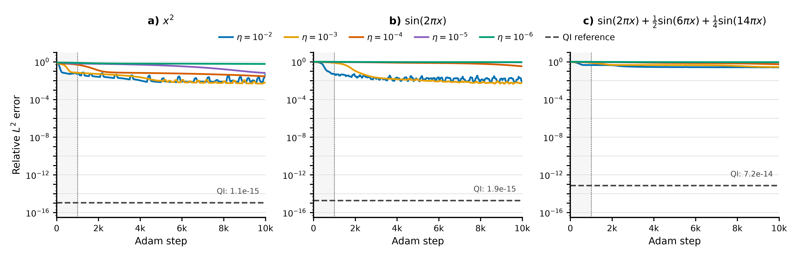

# Adam from standard initialization: matched comparison

All 15 runs completed 10,000 updates with 1,000-step linear warmup, using rates 1e-2, 1e-3, 1e-4, 1e-5, and 1e-6. Only the initial weights differ from the QI experiment: same targets, 269-neuron tanh MLP (808 trainable parameters), train/evaluation data, float64 arithmetic, optimizer settings, and evaluation schedule.

Standard initialization is the unmodified PyTorch Linear default: weights and biases are sampled uniformly in [-1/sqrt(fan_in), 1/sqrt(fan_in)]. Seed 0 is reset before each target. Every rate trains a fresh copy of the same random network. There is no QI weight loading, readout fitting, or target-dependent initialization. This is a single-seed controlled comparison, not a robustness study over seeds.

## Raw final relative L2 errors

| Target | Standard initial | lr=1e-2 | lr=1e-3 | lr=1e-4 | lr=1e-5 | lr=1e-6 |
|---|---:|---:|---:|---:|---:|---:|
| square | 8.394e-01 | 1.829e-02 | 5.088e-03 | 2.856e-02 | 6.605e-02 | 5.950e-01 |
| sine | 1.014e+00 | 7.319e-03 | 4.960e-03 | 3.306e-01 | 8.881e-01 | 9.290e-01 |
| sine_mixture | 1.012e+00 | 2.589e-01 | 2.813e-01 | 5.474e-01 | 8.812e-01 | 9.213e-01 |

## Matched QI-initialized final errors

The values below are the existing QI-initialized runs, not additional training or selected checkpoints.

| Target | lr=1e-2 | lr=1e-3 | lr=1e-4 | lr=1e-5 | lr=1e-6 |
|---|---:|---:|---:|---:|---:|
| square | 2.031e-03 | 1.501e-02 | 1.586e-04 | 4.748e-08 | 8.530e-07 |
| sine | 9.011e-02 | 2.192e-05 | 1.964e-07 | 6.168e-06 | 5.620e-06 |
| sine_mixture | 6.207e-03 | 9.747e-03 | 3.019e-04 | 4.354e-07 | 1.377e-09 |

## Validation

All saved checkpoints exactly reproduce their logged final errors. All 150,000 training losses are finite. Saved initial weights match PyTorch defaults bit for bit; train/evaluation grids, learning-rate schedules, and evaluation steps match the QI experiment exactly. Six focused tests pass, covering both initialization paths, a no-update control, warmup/indexing, the axis transform, and display smoothing. Independent Gauss-Legendre endpoint errors agree with midpoint-rule errors to within 4.149e-05 relative discrepancy.

## Figure

The dashed line is the previously measured **QI reference**, not the random network's initial error. Everything else about the presentation is matched: function titles above the legend, no point markers, same y limits, fully linear x-spacing, paper fonts, and 100-step log-error smoothing. The first 100 steps remain unsmoothed. Numerical tables use raw endpoint errors, so they can differ from the smoothed curve's endpoint.

- `standard_adam.png` / `.pdf`: main figure.
- `standard_adam_raw.png` / `.pdf`: unsmoothed companion.
- `summary.csv`: raw endpoint summary.
- `displayed_curves.json`: raw and displayed values.
- `config.json`, `provenance.json`, `figure_provenance.json`, `validation.json`: settings and checks.
- Target subdirectories: initial/final weights, data grids, evaluation histories, and every training loss.

Reproduction commands are in `experiments/expD55_qi_adam_drift/README.md`.
