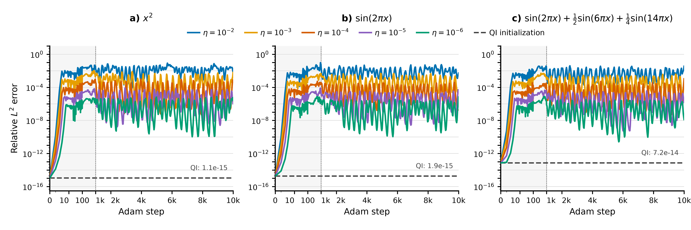

# Revised QI-to-Adam experiment

All 15 runs completed 10,000 full-batch Adam updates with 1,000-step linear warmup. Rates are 1e-2, 1e-3, 1e-4, 1e-5, and 1e-6. Targets, 269-neuron networks, float64 arithmetic, and data are unchanged from the original experiment. Every rate starts from the same QI weights for its target.

The main figure uses logarithmic x-spacing through step 1,000 in the left quarter and linear spacing afterward in the remaining three quarters (with a short linear segment from 0 to 1), no markers, and a centered five-sample moving average in log10(error), spanning 100 updates. Steps 0–100 remain unsmoothed; endpoint windows truncate. The companion raw figure retains every logged evaluation. Smoothing is only for display: final errors and statistics below use raw held-out errors.

## Final relative L2 errors

| Target | Initial QI | lr=1e-2 | lr=1e-3 | lr=1e-4 | lr=1e-5 | lr=1e-6 |
|---|---:|---:|---:|---:|---:|---:|
| square | 1.088e-15 | 2.031e-03 | 1.501e-02 | 1.586e-04 | 4.748e-08 | 8.530e-07 |
| sine | 1.855e-15 | 9.011e-02 | 2.192e-05 | 1.964e-07 | 6.168e-06 | 5.620e-06 |
| sine_mixture | 7.206e-14 | 6.207e-03 | 9.747e-03 | 3.019e-04 | 4.354e-07 | 1.377e-09 |

Endpoints can fall at different phases of the oscillations. The raw and smoothed versions are both saved so these excursions remain inspectable. This experiment describes this schedule and parameterization, not all possible Adam schedules.

## Post-warmup raw evaluations

Minimum, median and maximum below use the 361 logged held-out evaluations from steps 1,000 through 10,000, every 25 updates. They are not independent replicates.

| Target | Learning rate | Minimum | Median | Maximum |
|---|---:|---:|---:|---:|
| square | 0.01 | 3.076e-05 | 1.183e-02 | 6.717e-01 |
| square | 0.001 | 1.894e-07 | 1.934e-04 | 7.107e-02 |
| square | 0.0001 | 5.317e-09 | 1.436e-05 | 8.881e-03 |
| square | 1e-05 | 4.195e-10 | 1.594e-06 | 7.660e-04 |
| square | 1e-06 | 2.411e-11 | 2.232e-07 | 9.114e-05 |
| sine | 0.01 | 5.819e-04 | 3.253e-03 | 5.534e-01 |
| sine | 0.001 | 1.052e-05 | 1.288e-04 | 6.099e-02 |
| sine | 0.0001 | 9.798e-08 | 1.369e-05 | 5.427e-03 |
| sine | 1e-05 | 1.183e-09 | 1.732e-06 | 5.418e-04 |
| sine | 1e-06 | 5.417e-12 | 1.942e-07 | 5.976e-05 |
| sine_mixture | 0.01 | 1.225e-04 | 1.947e-03 | 4.726e-01 |
| sine_mixture | 0.001 | 1.275e-06 | 1.299e-04 | 4.869e-02 |
| sine_mixture | 0.0001 | 2.372e-08 | 1.159e-05 | 4.575e-03 |
| sine_mixture | 1e-05 | 4.018e-10 | 1.103e-06 | 5.849e-04 |
| sine_mixture | 1e-06 | 1.001e-11 | 1.079e-07 | 4.680e-05 |

## Validation

All 15 saved final checkpoints exactly reproduce their logged errors; all 150,000 training losses are finite. Every warmup schedule was checked, and each target's initial weights are bitwise identical to the previous experiment. The independent Gauss-Legendre endpoint check differs from the midpoint rule by at most 1.808e-06 relatively. Four targeted tests pass, covering transfer fidelity, no-update control, schedule indexing, and smoothing/onset preservation.

## Figures

Gray shading is the 1,000-step warmup. Dashed horizontal lines are the QI initial errors. The hard target is sin(2πx) + 0.5 sin(6πx) + 0.25 sin(14πx). Styling comes directly from the paper's Width Scaling / Bandwidth Selection / Precision Law style module; markers are removed.

- `qi_adam_drift.png` / `.pdf`: smoothed, log-to-linear x-axis.
- `qi_adam_drift_raw.png` / `.pdf`: raw, log-to-linear x-axis.
- `displayed_curves.json`: raw and displayed errors side by side.
- `summary.csv`: raw final errors and ratios.
- `figure_provenance.json`: smoothing specification, style and input hashes.
- `validation.json`: checkpoint and schedule checks.

The runner and plotter are in `experiments/expD55_qi_adam_drift/`. Their README gives the full protocol and reproduction commands. Previous 2,000-step warmup results remain in the parent directory.
